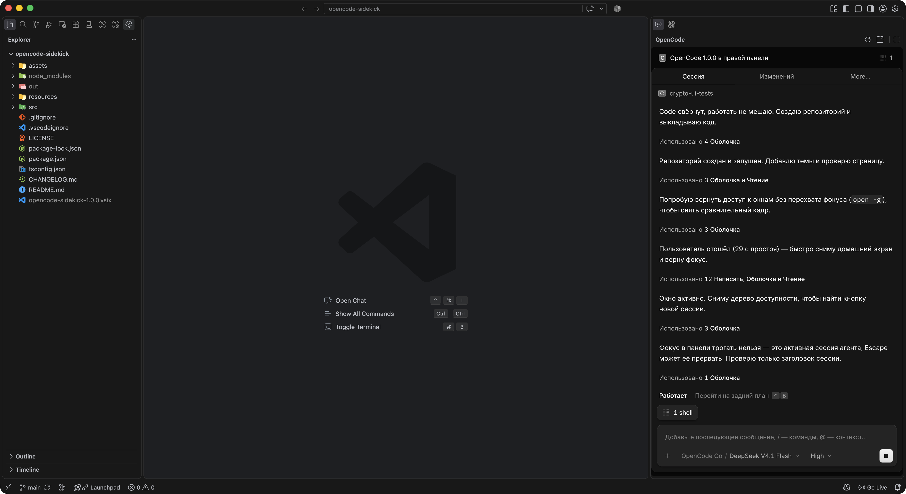
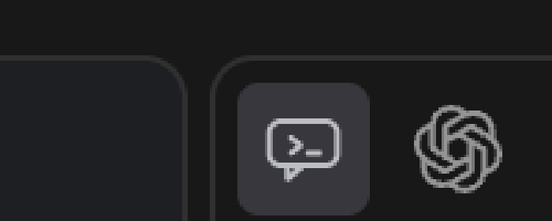
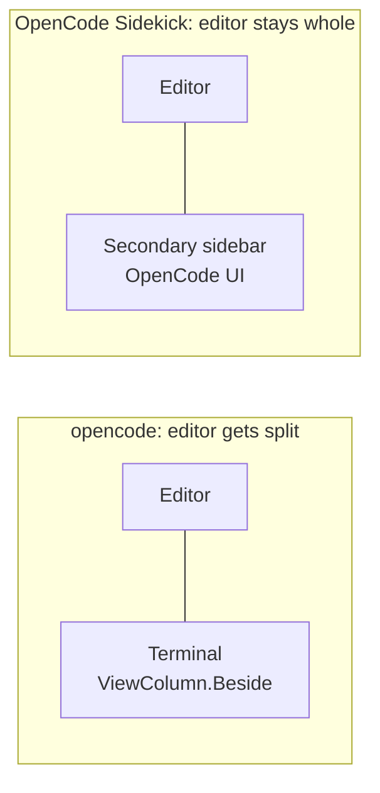

# OpenCode Sidekick

**The OpenCode agent, docked in the VS Code secondary sidebar.** Your editor keeps its full width, OpenCode sits right next to it, in the same panel where Copilot Chat and Codex live.



## The problem it solves

The official opencode extension opens its terminal with `ViewColumn.Beside`. That forces the editor to split into two columns every time you want to talk to your agent: half the screen is code, half is a terminal, and your tabs get squeezed into whatever space is left.

OpenCode Sidekick declares its own container in `secondarySidebar`, so the OpenCode UI opens in the right-hand panel that VS Code already toggles with `Cmd+Option+B`. The editor area is never split.

| | opencode (official) | OpenCode Sidekick |
| --- | --- | --- |
| Where it opens | Terminal in a new editor column | Webview in the secondary sidebar |
| Editor layout | Split into two columns | Untouched |
| Survives view switching | Yes | Yes (`retainContextWhenHidden`) |
| Same sessions, models, config | Yes | Yes |

## What you get

- The real OpenCode UI, not a reimplementation. Same sessions, same models, same agents, same tools as the CLI.
- A dedicated icon in the secondary sidebar activity bar, next to your other chat panels:



- Automatic connection: if no OpenCode server is running, the extension starts it for you.
- Live streaming over the OpenCode event stream, so the panel updates as the agent works.
- Escape hatches: reload the panel, open the same UI in your browser, or drop back to the integrated terminal.

## Install

Requires VS Code 1.101 or newer and the OpenCode CLI on your machine.

```bash
code --install-extension opencode-sidekick-1.0.0.vsix
```

Or in VS Code: Extensions view → `...` → **Install from VSIX**.

## Use it

1. Open the secondary sidebar with `Cmd+Option+B` (`Ctrl+Alt+B` on Windows and Linux).
2. Click the OpenCode icon.
3. Talk to your agent.

You can also run **OpenCode: Focus OpenCode Sidekick** from the Command Palette, or press `Cmd+Alt+O` (`Ctrl+Alt+O`).

## Commands

| Command | Description |
| --- | --- |
| `OpenCode: Focus OpenCode Sidekick` | Reveal and focus the sidebar panel |
| `OpenCode: Reload OpenCode Sidekick` | Reconnect and reload the panel |
| `OpenCode: Open OpenCode UI in Browser` | Open the authenticated UI in your default browser |
| `OpenCode: Open OpenCode in Integrated Terminal` | Fall back to the classic TUI in the bottom panel |

## Settings

| Setting | Default | Description |
| --- | --- | --- |
| `opencodeSidekick.cliPath` | `""` | Absolute path to the `opencode` executable. Empty means "first one on `PATH`". |
| `opencodeSidekick.autoStartServer` | `true` | Start the OpenCode background server when the panel opens and nothing is listening. |

## How it works

The panel is a webview that hosts the OpenCode web UI. The extension reads the running server's endpoint from `~/.local/state/opencode/service.json`, starts a small loopback proxy that attaches the server's credentials, and points the webview at that proxy. The UI runs in its own origin inside the sidebar, and streaming keeps working because the proxy forwards the event stream unchanged.



## Notes

- Credentials never leave your machine. The proxy listens on `127.0.0.1` only and exists for the lifetime of the extension host.
- If the OpenCode server restarts with new credentials, run **Reload OpenCode Sidekick**.
- The UI itself is OpenCode's own web interface, so its language follows your system locale.

## License

MIT
