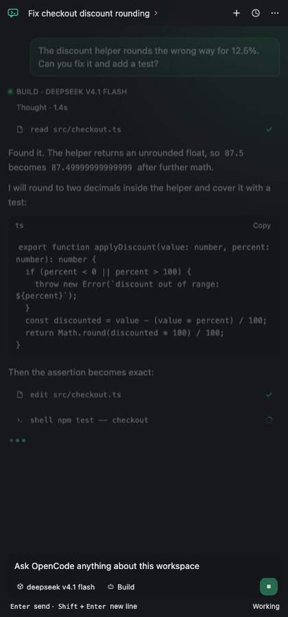
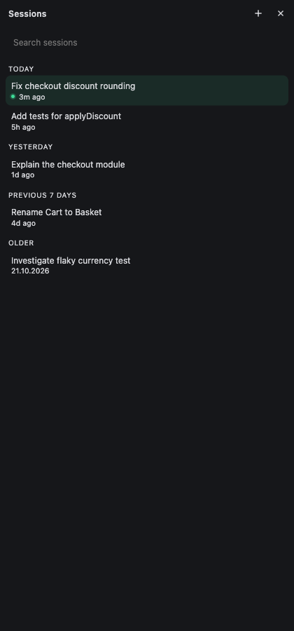
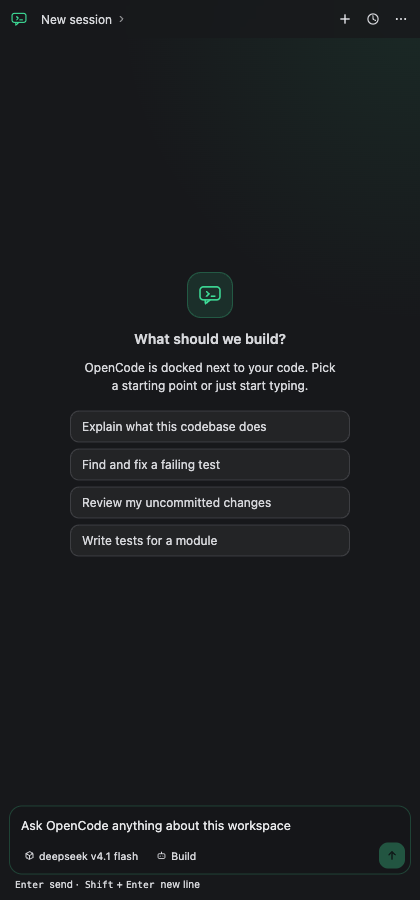

# OpenCode Sidekick

**The OpenCode agent, docked in the VS Code secondary sidebar.** Your editor keeps its full width, OpenCode sits right next to it, in the same panel where Copilot Chat and Codex live.



## The problem it solves

The official opencode extension opens its terminal with `ViewColumn.Beside`. That forces the editor to split into two columns every time you want to talk to your agent: half the screen is code, half is a terminal, and your tabs get squeezed into whatever space is left.

OpenCode Sidekick declares its own container in `secondarySidebar`, so OpenCode opens in the right-hand panel that VS Code already toggles with `Cmd+Option+B`. The editor area is never split, and the panel is a real chat UI instead of a terminal emulator squeezed into a column.

| | opencode (official) | OpenCode Sidekick |
| --- | --- | --- |
| Where it opens | Terminal in a new editor column | Webview in the secondary sidebar |
| Editor layout | Split into two columns | Untouched |
| Typing, pasting, code blocks | TUI inside a terminal | Native textarea and markdown |
| Sessions | One terminal at a time | Built-in history, search and new sessions |
| Same sessions, models, config | Yes | Yes |


## What you get

- **The real OpenCode agent.** The panel talks to the OpenCode server over its HTTP API and event stream, so sessions, models, agents, tools and permissions are the same ones your CLI uses.
- **A UI built for a narrow column.** User bubbles, streamed markdown, syntax-highlighted code blocks with a copy button, collapsible reasoning, and compact tool cards with live status.
- **Working text input.** Paste with `Cmd+V` / `Ctrl+V`, multi-line prompts with `Shift+Enter`, `Enter` to send.
- **Session history.** Grouped by Today / Yesterday / Previous 7 days / Older, with search, one-click switching and delete.
- **New sessions in one click.** The `+` button in the header, or `Cmd+Alt+N`.
- **Searchable model picker.** Filter the server's model list by name, id or provider, then switch without leaving the composer.
- **Reasoning effort.** Pick the model's `low` / `medium` / `high` / `max` variants from the effort chip, or leave it on default.
- **Mode picker.** Switch between the primary agents the server exposes, such as Build and Plan, per session.
- **Slash commands and mentions.** Type `/` to run any server command, and `@` to search files or invoke a skill. Arrow keys, Enter, Tab and Escape work in both palettes.
- **File and skill attachments.** Selected files and skills are sent with the prompt using the OpenCode attachment API.
- **Defaults that show up.** New sessions use configured model, effort and mode defaults, and the composer shows the server defaults when a session has no explicit selection.
- **Settings that stay put.** A settings drawer controls defaults, send key, auto-scroll, timestamps, reasoning visibility, compact tools, accent color, density, font size, CLI path and server auto-start. Changes apply immediately and do not reset your draft.
- **Stop button.** Interrupt a running turn without hunting for a key chord.

## Screens





## Install

Requires VS Code 1.101 or newer and the OpenCode CLI on your machine.

```bash
code --install-extension opencode-sidekick-1.2.0.vsix
```

Or in VS Code: Extensions view → `...` → **Install from VSIX**.

## Use it

1. Open the secondary sidebar with `Cmd+Option+B` (`Ctrl+Alt+B` on Windows and Linux).
2. Click the OpenCode icon.
3. Talk to your agent.

The panel opens on your most recent session for the current workspace. Use `+` for a new one, or the title to browse history.

The composer footer has three pickers: model, effort and mode. Type `/` at the start of a message to filter commands, or `@` anywhere to search files and skills. In a palette, use `Up` / `Down` to move, `Enter` or `Tab` to select, and `Escape` to close it. The `...` menu in the header repeats the main panel actions, including the three pickers.

## Commands

| Command | Shortcut |
| --- | --- |
| `OpenCode: Focus OpenCode Sidekick` | `Cmd+Alt+Shift+O` |
| `OpenCode: New Session` | `Cmd+Alt+N` |
| `OpenCode: Show Session History` | |
| `OpenCode: Open Sidekick Settings` | |
| `OpenCode: Reload OpenCode Sidekick` | |
| `OpenCode: Open OpenCode UI in Browser` | |
| `OpenCode: Open OpenCode in Integrated Terminal` | |

## Settings

| Setting | Default | Description |
| --- | --- | --- |
| `opencodeSidekick.defaultModel` | `""` | Default model for new sessions as `provider/model`. Empty uses the server default. |
| `opencodeSidekick.defaultEffort` | `""` | Default reasoning effort for new sessions. Empty lets the model decide. |
| `opencodeSidekick.defaultMode` | `""` | Default agent mode for new sessions. Empty uses the server default. |
| `opencodeSidekick.sendKey` | `enter` | `enter` sends with Enter; `mod-enter` sends with Cmd/Ctrl+Enter. |
| `opencodeSidekick.autoScroll` | `true` | Keep the transcript scrolled to new output. |
| `opencodeSidekick.showTimestamps` | `false` | Show message times. |
| `opencodeSidekick.reasoning` | `collapsed` | Show reasoning `collapsed`, `expanded` or `hidden`. |
| `opencodeSidekick.compactTools` | `true` | Collapse tool input and output by default. |
| `opencodeSidekick.accent` | `mint` | Accent color: `mint`, `blue`, `violet` or `amber`. |
| `opencodeSidekick.density` | `comfortable` | Spacing density: `comfortable` or `compact`. |
| `opencodeSidekick.fontSize` | `default` | Base font size: `small`, `default` or `large`. |
| `opencodeSidekick.cliPath` | `""` | Absolute path to the `opencode` executable. Empty means "first one on `PATH`". |
| `opencodeSidekick.autoStartServer` | `true` | Start the OpenCode background server when the panel opens and nothing is listening. |

The same settings are available in the panel: click the gear in the header, choose **Settings** from the `...` menu, or run `OpenCode: Open Sidekick Settings`.

## How it works

The extension reads the running server's endpoint and credentials from `~/.local/state/opencode/service.json`, then talks to it directly: `GET /api/session` for history, `POST /api/session/{id}/prompt` to send, `POST /api/session/{id}/command` for slash commands, `GET /api/session/{id}/message` for transcripts, and `GET /api/event` for the live stream. Models, agents, commands, skills, and free-text file search come from `GET /api/model`, `/api/agent`, `/api/command`, `/api/skill`, and `/api/fs/find`. Deltas arrive over SSE and are applied to the transcript as they stream; structural events trigger a re-read so tool cards, model, and agent changes stay accurate.

The webview is a React 19 app bundled with esbuild into `media/main.js` and inlined into the panel with a nonce-based CSP. The source follows a pragmatic Feature-Sliced Design layout (`app -> widgets -> features -> entities -> shared`); see [ARCHITECTURE.md](ARCHITECTURE.md). Everything stays on your machine. No proxy process, no iframe, no extra port.

## Notes

- If the OpenCode server restarts with new credentials, run **Reload OpenCode Sidekick**.
- The panel follows your VS Code theme for surfaces and text. The accent color is configurable in settings.
- Changing model, effort, mode or any setting updates the panel in place. Your composer draft is not cleared.
- Code that the agent writes is still handled by OpenCode itself, so its own permission prompts apply.

## License

MIT
